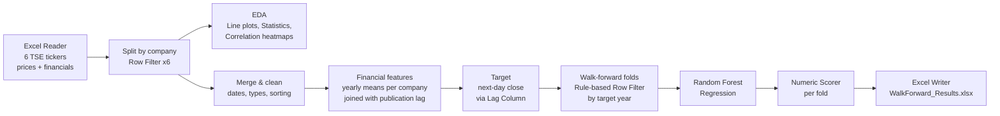

# Walk-Forward Next-Day Close Forecasting on the Tehran Stock Exchange (KNIME)

A compact, no-code KNIME workflow that shows the **end-to-end structure of a stock-price forecasting project**: data loading, EDA, leakage-aware feature construction from financial statements, expanding-window walk-forward validation, and a Random Forest baseline.

> **Scope note.** This is a minimal teaching/portfolio workflow, not a trading model. The goal is to demonstrate a clean, time-respecting pipeline. See [Limitations](#limitations).

## Workflow overview



The full node graph is in [`docs/workflow.svg`](docs/workflow.svg) (wide image, open it in a browser and zoom).

## Data

- **Universe:** 6 companies listed on the Tehran Stock Exchange (Bfajr, Boali, Bshahab, Fajam, Fajr, Fama)
- **Size:** 11,691 daily rows, 28 columns
- **Market data:** open, high, low, close, adjusted close, value, volume, trade count
- **Financial-statement data:** fixed/current/total assets, fixed/current/total liabilities, equity, shares outstanding, trade receivables, PPE, sales revenue, net income, CFO, CapEx, plus industry
- **Calendar:** Jalali (Persian) dates; folds are defined on Jalali years

The raw data file is **not included** in this repository (see [Data availability](#data-availability)).

## Method

1. **EDA.** Per-company line plots, descriptive statistics and linear-correlation heatmaps.
2. **Financial features without look-ahead.** Annual financial-statement values are aggregated per company and fiscal year, then joined to daily rows using an *availability rule* that accounts for publication delay: for dates in months 1-4 of a year the previous-previous fiscal year is used, otherwise the previous fiscal year. Rows before the first fully available fiscal year are dropped.
3. **Target.** Next-day close, built with a Lag Column node (`close(-1)`).
4. **Walk-forward validation (expanding window).** Folds are assigned by the year of the *target* date, so a row never straddles the train/test boundary.

   | Fold | Train (target year) | Test (target year) | Test rows |
   |------|--------------------|--------------------|-----------|
   | 1 | <= 1400 | 1401 | 1,248 |
   | 2 | <= 1401 | 1402 | 1,369 |
   | 3 | <= 1402 | 1403 | 1,184 |
   | 4 | <= 1403 | 1404 | 1,217 |

5. **Model.** Random Forest (regression), 1,000 trees, fixed random seed, no resampling.
6. **Evaluation.** Numeric Scorer on each test fold; results exported to Excel.

## Results

| Fold (test year) | R² | MAE | RMSE | MAPE |
|---|---|---|---|---|
| 1 (1401) | 0.638 | 1,074.9 | 2,275.3 | 24.8% |
| 2 (1402) | 0.726 | 2,401.7 | 4,293.6 | 26.4% |
| 3 (1403) | 0.926 | 1,476.5 | 3,042.8 | 13.4% |
| 4 (1404) | 0.978 | 1,092.0 | 1,729.8 | 17.2% |

Full scorer output (including mean signed difference) is in [`results/WalkForward_Results.xlsx`](results/WalkForward_Results.xlsx).

## Limitations

- **Price levels, not returns.** The model predicts the next-day *price level*. Because tomorrow's close is very close to today's close, a high R² on levels is expected and says little about forecasting skill. A naive "tomorrow = today" benchmark is the right comparison and is not yet included.
- **Tree models cannot extrapolate.** In trending, high-inflation markets, a Random Forest trained on past price ranges tends to under-predict new highs. The consistently signed mean signed difference across all four folds points to a systematic bias.
- **Pooled across 6 companies** with different price scales; pooled metrics mix between-company and within-company variance.
- **Small universe and few folds.** Six tickers and four test years, with no hyperparameter tuning or statistical significance tests.
- **Reported "adjusted R²" equals R²** in the scorer output; ignore it.

## Possible next steps

- Add a naive and a moving-average baseline, and compare MAE/RMSE against them
- Predict **returns** (or log returns) instead of price levels; add technical indicators
- Per-company metrics and error plots
- Parameter Optimization Loop and feature-importance analysis
- Statistical tests (e.g. Diebold-Mariano) against the baseline

## Repository structure

```
.
├── README.md
├── workflow/
│   └── Hmarah_aval_academy_project.knwf
├── results/
│   └── WalkForward_Results.xlsx
└── docs/
    └── workflow.svg
```

## How to run

1. Install [KNIME Analytics Platform](https://www.knime.com/downloads) (workflow built with 5.x).
2. In KNIME: *File > Import KNIME Workflow...* and select the `.knwf` file.
3. Open the **Excel Reader** node and point it to your own data file with the columns listed above.
4. Execute all nodes.


